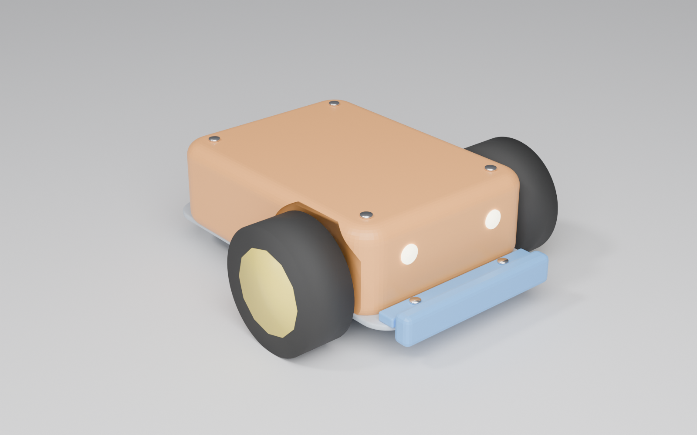
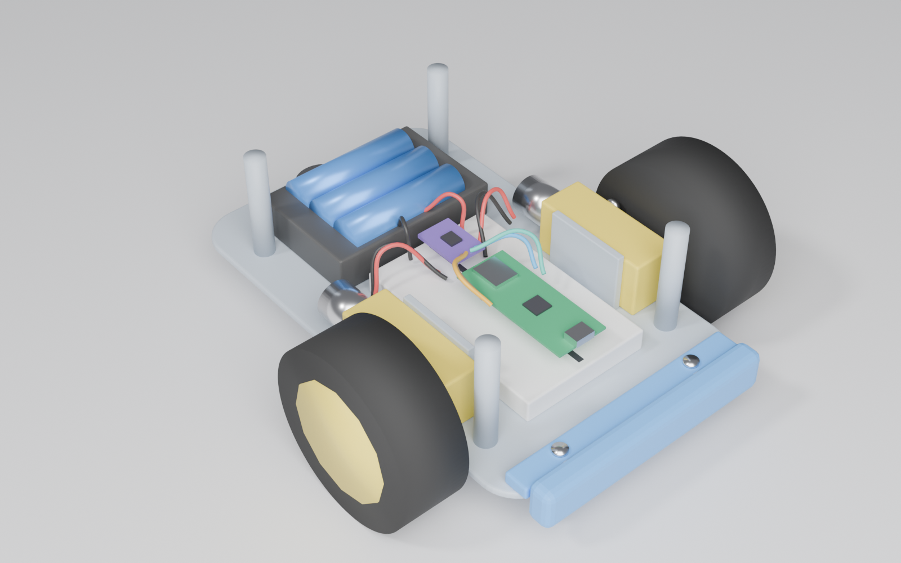

# PicoRuby ラジコンカー

Raspberry Pi Pico 2 W と PicoRuby、3D プリンタで作る、親子向けの BLE ラジコンカーです。
Android や PC の Chrome で開いた Web コントローラーから操作します。

> **4WD 版に移行中です。** タミヤ ダブルギヤボックス 2 箱（FA-130 ×4）で 4 輪を回し、TPU で印刷したパドル付きタイヤで砂の上も走れるようにします。今の 2 輪版より 2 倍以上速くなる見込みです。
> - 済み: ファーム（`MAX_DUTY`）、配線（DRV8833 ×2）、タイヤのスクリプト（`cad/RcTire`）、部品表
> - まだ: 底板（`cad/RcCarChassis`）。ギヤボックスの実物を測ってから作り直します



<details><summary>ボディを外したところ</summary>



</details>

> 画像は `docs/images/render_car.py` を Blender で実行して作った完成イメージです（細かいところは簡略化しています）。

```
rc-car/
├── firmware/app.rb            PicoRuby の制御コード (/home/app.rb に置く)
├── controller/index.html      Web コントローラー (Chrome で開く)
├── cad/RcCarChassis/          Fusion 用スクリプト (底板・ボディ・バンパー)
├── cad/RcTire/                Fusion 用スクリプト (4WD 版のパドル付きタイヤ、TPU で印刷)
└── docs/                      部品表 (BOM.md)、配線 (wiring.md / wiring.svg)、組み立て (assembly.md)
```

## 作る流れ

組み立ての詳しい手順は [docs/assembly.md](docs/assembly.md) にあります。

| # | やること | 担当の目安 |
|---|---|---|
| 1 | 部品をそろえる（[docs/BOM.md](docs/BOM.md)） | 大人 |
| 2 | Fusion でスクリプトを実行し、STL を印刷する | 大人 |
| 3 | モーター・キャスター・電池ボックスを底板に付ける | 一緒に |
| 4 | 配線する（[docs/wiring.md](docs/wiring.md)） | 大人が読み上げて、子供が差す |
| 5 | ファームを書き込み、app.rb を転送する | 大人 |
| 6 | タイヤを浮かせて動作確認 → ボディをネジ止め | 子供 |
| 7 | 走らせる。`app.rb` の数字を変えて遊ぶ | 子供 |

## 1. 3D モデル（Fusion）

1. Fusion を開き、**ユーティリティ > アドイン > スクリプトとアドイン** を選ぶ
2. 「＋」から `cad/RcCarChassis` フォルダを追加して、`RcCarChassis` を実行する
3. 新しいデザインに `Chassis` / `Body` / `Bumper` が作られる。STL は `cad/RcCarChassis/stl/` に書き出される

寸法を変えたいときは、`RcCarChassis.py` の冒頭にある `P` を書き換えてもう一度実行します（毎回、新しいデザインとして作り直します）。
- `name_text`: ボディの上に彫る文字。ふだんは空で、何も彫らない。入れるときは英字で書く（日本語を使うときは `name_font` を日本語フォントにする）
- `body_corner_r` / `body_top_r`: ボディの角の丸み（四隅 / 上面のふち）
- `tt_*`: TT モーターの寸法。**製品によって穴の位置が違うので、実物をはかって直す**
- `caster_h`: 使うボールキャスターの高さ。底板の下に付く台座の高さを自動で計算する

**印刷のめやす**（PLA、ノズル 0.4mm）
- Chassis: そのまま。インフィル 20%
- Body: **スライサーで裏返し、上面を下にして**印刷する（開いた面を下にすると、広い天井をサポートで支えることになる）。上面のふちの丸みは少しだれることがあるので、気になるときはサポートを「ビルドプレートからのみ」で付ける
- Bumper: そのまま。すき間の部分にはサポートなしでブリッジできる
- 底板は 176 × 108mm、ボディは 152 × 113mm。**Bambu Lab A1 mini（180mm 角）でも印刷できる**（バンパーは別に印刷する）

**組み立て**
- TT モーター: M3×25 のなべネジを、モーターの外側（タイヤ側）から モーター → 壁 の順に通し、壁の内側をナットで留める
- キャスター: 底板の後ろ、下側に M3 で留める
- 電池ボックス・ブレッドボード: 枠の中に両面テープで貼る
- Pico: ブレッドボードに直接さす（USB を前に向ける）
- バンパー: 底板の前の端に差し込み、M2 で留める
- ボディ: 上からかぶせて、M2 タッピングネジ 4 本で柱に留める

## 2. ファームウェア（PicoRuby）

1. https://github.com/picoruby/picoruby/releases から `R2P2-PICORUBY-<version>-PICO2_W-*.uf2.zip` をダウンロードして展開する（**4.0.4 以上**を使う。それより前は BLE でメモリリークがある）
2. Pico の BOOTSEL ボタンを押しながら USB をつなぐ
3. 出てきたドライブに `.uf2` をドラッグする
4. Chrome で https://picoruby.org/terminal.html を開いて Pico に接続し、`firmware/app.rb` を `/home/app.rb` としてアップロードする
   - 別の方法: R2P2 シェルで `vim /home/app.rb` を開き、中身を貼り付ける
5. Pico をリセットすると `app.rb` が自動で動き出す。オンボード LED が点滅していれば、つながるのを待っている状態

> PicoRuby 4.x の Pico は、USB ドライブとしては見えません。ファイルは Web Terminal か PicoModem（`picoruby tools/picomodem.rb put app.rb /home/app.rb`）で転送します。

## 3. 動作確認（タイヤを浮かせてから）

1. スマホに **nRF Connect** を入れて `KURUMA-1` に接続する
2. Nordic UART の RX に、テキストで `D 50 50` を送る。両方のタイヤが前向きに回れば OK
   - 逆に回るときは、モーターの線を入れ替えるか、`INVERT_L` / `INVERT_R` を `true` にする
3. 何も送らずにいると、0.5 秒で止まることを確かめる（フェイルセーフ）

## 4. 走らせる

- **https://phigasui.github.io/picoruby-rc-car/controller/** を **Android か PC の Chrome** で開き、「つなぐ」を押して `KURUMA-1` を選ぶ
  - iPhone の Safari は Web Bluetooth に対応していないので使えない
  - スマホから開くときは、GitHub Pages など **https** のページに置く（Web Bluetooth は https か localhost でしか動かない）
- 矢印を押している間だけ走る。離すと止まる
- 速さは 🐢 / 🐇 / 🚀 で切り替える
- 💃 を押すと、`DANCE` に書いた動きをする
- PC ではキーボードの矢印キーで動かせる（2 つ同時に押すとななめ）。スペースキーでおどる

## 5. 子供がいじるところ（`app.rb` の冒頭）

```ruby
NAME = "KURUMA-1"      # スマホに出てくる名前
MAX_SPEED = 70         # いちばん速いスピード
DANCE = [              # おどりの動き [左, 右, 何秒]
  [ 100,  100, 0.5],
  ...
]
```

数字を書き換えて保存し、Pico をリセットすると反映されます。
「`DANCE` に 1 行足すと、どう変わる？」から始めるのがおすすめです。

## 通信のやくそく（BLE Nordic UART、1 行ずつ）

| コマンド | 意味 |
|---|---|
| `D <左> <右>` | 左右の速さを -100〜100 で指定して走る（`MAX_SPEED` を掛けた値になる） |
| `S` | 止まる |
| `X` | おどる |

最後のコマンドから 500ms 何も来なければ止まります（おどっている間は除く）。BLE が切れたときも止まります。

## まだ確かめていないこと（実機で確認してください）
- PicoRuby 4.x で `require 'pwm'` が必要かどうか（`app.rb` では、失敗しても止まらないように書いてある）
- TT モーターの取付穴の位置（製品によって違う）
- `BLE::UART` に Android の Chrome からつなげるか。PicoRuby の BLE はまだ実験的な機能で、Mac との組み合わせでしか試されていない
