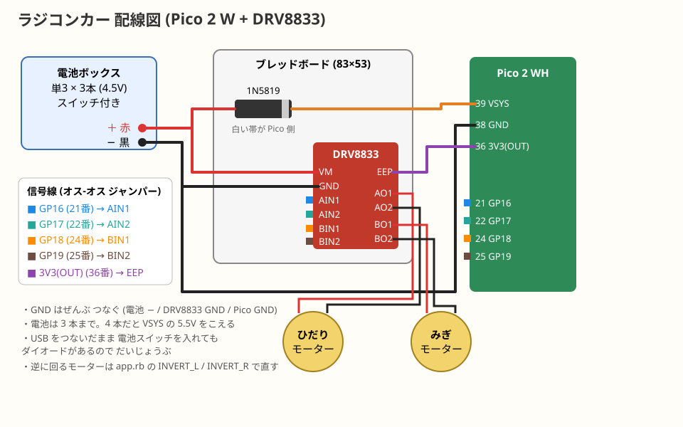

# 配線

## 電源

| どこから | どこへ | メモ |
|---|---|---|
| 電池ボックス ＋（赤） | DRV8833 VM（Pololu #2130 では **VIN**。VMM ではない） | モーター用 |
| 電池ボックス ＋（赤） | 1N5819 の帯のない側 | |
| 1N5819 の白い帯の側 | Pico **VSYS（39 番ピン）** | USB と電池を同時につないでも大丈夫 |
| 電池ボックス −（黒） | DRV8833 GND | |
| 電池ボックス −（黒） | Pico **GND（38 番ピン）** | **GND はぜんぶ共通にする** |
| Pico **3V3(OUT)（36 番ピン）** | DRV8833 nSLEEP（EEP / SLP） | Pololu #2130 は基板上でプルアップされているので配線しなくてよい |

## 信号（Pico → DRV8833）

| Pico | ピン番号 | DRV8833 | 何をする |
|---|---|---|---|
| GP16 | 21 | AIN1 | 左モーター |
| GP17 | 22 | AIN2 | 左モーター |
| GP18 | 24 | BIN1 | 右モーター |
| GP19 | 25 | BIN2 | 右モーター |

## モーター

| DRV8833 | モーター |
|---|---|
| AO1 / AO2 | 左モーターの 2 本 |
| BO1 / BO2 | 右モーターの 2 本 |

モーターの線の向きは、どちらでもかまいません。前に進まないときは、2 本を入れ替えるか、`app.rb` の `INVERT_L` / `INVERT_R` を `true` にします。

## 注意
- 電池は**単3 を 3 本**にする。4 本（6V）だと Pico の VSYS の上限 5.5V を超えて、壊れることがある
- 配線を変えるときは、電池のスイッチを切って USB も抜く
- ピン番号は、Pico を上から見て USB が上にあるとき、左上が 1 番、右上が 40 番
